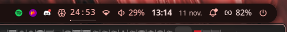

# FocusFlow

A Pomodoro timer for the Noctalia bar that also keeps track of your focus time.
It has a live countdown on the bar and a panel with a calendar heatmap, streaks
and charts showing when you focus best.



## Features

- **Bar widget**: stage icon, live countdown and a thin progress line. When idle
  it shows today's finished sessions.
- **Timer panel**: large clock, round dots, start/pause, ±1 minute, skip,
  restart and new cycle. A *Today* card shows goal progress, your streak and
  the last 7 days.
- **Insights**: four summary tiles, a 26-week heatmap with a tooltip per day,
  a 14-day trend, time-of-day and weekday charts, your best day and your
  completion rate.
- **Reliable timer**: deadlines follow the real clock, so the timer stays
  correct through suspend and lag. A running session resumes after the shell
  restarts.
- **Alerts**: a notification when each stage ends, plus an optional sound.
- **IPC**: control everything from keybinds and scripts.

## Plugin

| Field | Value |
| --- | --- |
| ID | `adam-gassem/focusflow` |
| Entries | Service: `engine`; bar widget: `widget`; panel: `panel` |

## Requirements

None beyond Noctalia. The optional completion sound is played with `pw-play`,
which comes with PipeWire.

## Installation

```sh
git clone https://github.com/Adam-Gassem/focusflow ~/Projects/focusflow
ln -s ~/Projects/focusflow ~/.local/share/noctalia/plugins/focusflow
noctalia msg plugins enable adam-gassem/focusflow
```

Then add the widget in **Settings → Bar → Add widget → FocusFlow**, or add it
in `config.toml`:

```toml
[widget.focusflow]
type = "adam-gassem/focusflow:widget"

["bar"."default"]
"end" = [ "tray", "focusflow", "network", "volume", "clock" ]
```

## Usage

| Action on the bar widget | Effect |
| --- | --- |
| Left click | Open or close the panel |
| Right click | Start / pause |
| Middle click | Skip to the next stage |
| Scroll | Add or remove one minute on the running stage |

The panel has two tabs: **Timer** for controlling the session, and
**Insights** for statistics. Hover any heatmap cell or bar to see its exact
values.

A cycle is a series of focus sessions with short breaks in between, ending with
a long break. The dots under the clock show where you are in the current cycle.

```sh
noctalia msg panel-toggle adam-gassem/focusflow:panel            # Timer tab
noctalia msg panel-toggle adam-gassem/focusflow:panel insights   # Insights tab
```

## Settings

| Setting | Type | Default | Description |
| --- | --- | --- | --- |
| `work-minutes` | `int` | `25` | Length of a focus session, in minutes. |
| `short-break-minutes` | `int` | `5` | Length of a short break, in minutes. |
| `long-break-minutes` | `int` | `15` | Length of the long break at the end of a cycle, in minutes. |
| `rounds` | `int` | `4` | Focus sessions per cycle before the long break. |
| `auto-start-breaks` | `bool` | `true` | Start the break as soon as a focus session ends. |
| `auto-start-work` | `bool` | `false` | Start the next focus session as soon as a break ends. |
| `daily-goal-minutes` | `int` | `120` | Daily focus target. It drives the goal bar, and full colour on the heatmap means the goal was met. `0` disables the goal, and the heatmap then scales against your busiest day. |
| `log-partial` | `bool` | `true` | Also record focus sessions you skip or restart, if they lasted at least one minute. |
| `notify` | `bool` | `true` | Show a notification when a stage ends. |
| `sound` | `bool` | `true` | Play a sound when a stage ends. |
| `sound-file` | `string` | `/usr/share/sounds/freedesktop/stereo/complete.oga` | Audio file passed to `pw-play`. |

Widget settings, set per widget instance:

| Setting | Type | Default | Description |
| --- | --- | --- | --- |
| `show-idle-count` | `bool` | `true` | Show today's finished sessions next to the icon while idle. |
| `show-progress` | `bool` | `true` | Show the progress line under the countdown. |

## IPC

```sh
noctalia msg plugin adam-gassem/focusflow:engine all <event>
```

| Event | Description |
| --- | --- |
| `toggle` | Start if idle or paused, pause if running. |
| `start` | Start or resume the current stage. |
| `pause` | Pause the current stage. |
| `skip` | End the current stage and move to the next one. |
| `reset` | Restart the current stage from its full length. |
| `stop` | Stop and go back to the first focus session of a cycle. |
| `focus` | Jump straight into a focus session, even during a break. |
| `plus` / `minus` | Add or remove one minute on the current stage. |

Example Hyprland binds:

```ini
bind = SUPER, P, exec, noctalia msg plugin adam-gassem/focusflow:engine all toggle
bind = SUPER SHIFT, P, exec, noctalia msg panel-toggle adam-gassem/focusflow:panel insights
```

## Notes

- History is stored locally in
  `~/.local/state/noctalia/plugins/data/adam-gassem/focusflow/history.json`.
  It is never sent anywhere. Each focus session is one record:
  `s` start, `e` end (Unix seconds), `d` seconds focused, `p` planned length,
  `c` completed.
- Only focus time is recorded; breaks are not.
- Days follow your local time zone. A session counts towards the day it started.
- The timer state is saved to `state.json` in the same folder, which is how a
  running session survives a shell restart.

## License

[MIT](LICENSE)
